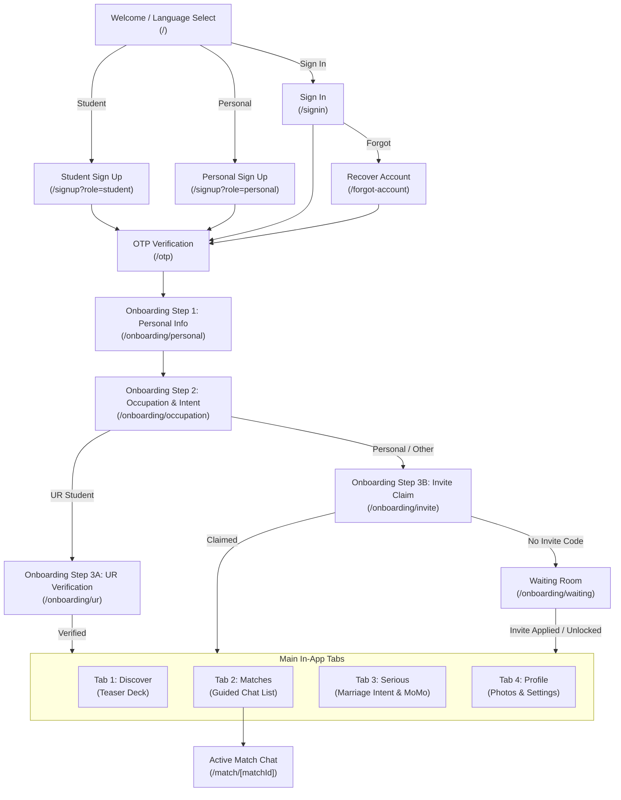

# kinn UI Structure & Translation Map

This document maps every screen, file path, and localization key across both the Expo mobile app (`artifacts/kin`) and the Vite web app (`artifacts/kin-web`).

---

## 1. Flow Architecture

---

## 2. Screen-by-Screen Map & Key Inventory

### 2.1 First Touch: Welcome & Language Picker
| Metric | Detail |
|---|---|
| **Mobile File** | [`artifacts/kin/app/(onboarding)/welcome.tsx`](file:///home/antigravity/htuyishi-hub/kin/artifacts/kin/app/(onboarding)/welcome.tsx) |
| **Web File** | [`artifacts/kin-web/src/pages/WelcomeScreen.tsx`](file:///home/antigravity/htuyishi-hub/kin/artifacts/kin-web/src/pages/WelcomeScreen.tsx) |
| **Route** | `/(onboarding)/welcome` (mobile), `/` (web) |
| **Keys Used** | `welcome.tagline` `welcome.studentSignUp` `welcome.orDivider` `welcome.personalSignUp` `welcome.alreadyHaveAccount` `welcome.signInAction` `welcome.urBadge` `welcome.inviteBadge` `welcome.selectLanguage` |

---

### 2.2 Authentication Flow

#### A. Email Sign Up (Role-gated: UR Student vs Personal)
| Metric | Detail |
|---|---|
| **Mobile File** | [`artifacts/kin/app/(onboarding)/email.tsx`](file:///home/antigravity/htuyishi-hub/kin/artifacts/kin/app/(onboarding)/email.tsx) |
| **Web File** | [`artifacts/kin-web/src/pages/EmailScreen.tsx`](file:///home/antigravity/htuyishi-hub/kin/artifacts/kin-web/src/pages/EmailScreen.tsx) |
| **Route** | `/(onboarding)/email` (mobile), `/signup` (web) |
| **Keys Used** | `auth.email.back` `auth.email.studentTitle` `auth.email.personalTitle` `auth.email.inputLabel` `auth.email.placeholder` `auth.email.sendCode` `auth.email.alreadyHaveAccount` `auth.email.signInAction` `auth.email.enterEmail` `auth.email.invalidFormat` `auth.email.sendFailed` |

#### B. Sign In
| Metric | Detail |
|---|---|
| **Mobile File** | [`artifacts/kin/app/(onboarding)/sign-in.tsx`](file:///home/antigravity/htuyishi-hub/kin/artifacts/kin/app/(onboarding)/sign-in.tsx) |
| **Web File** | [`artifacts/kin-web/src/pages/SignInScreen.tsx`](file:///home/antigravity/htuyishi-hub/kin/artifacts/kin-web/src/pages/SignInScreen.tsx) |
| **Route** | `/(onboarding)/sign-in` (mobile), `/signin` (web) |
| **Keys Used** | `auth.signIn.title` `auth.signIn.emailLabel` `auth.signIn.emailPlaceholder` `auth.signIn.sendCode` `auth.signIn.forgotAccount` `auth.signIn.noAccount` `auth.signIn.createAccount` `auth.signIn.accountNotFound` |

#### C. Forgot / Recover Account
| Metric | Detail |
|---|---|
| **Mobile File** | [`artifacts/kin/app/(onboarding)/forgot-account.tsx`](file:///home/antigravity/htuyishi-hub/kin/artifacts/kin/app/(onboarding)/forgot-account.tsx) |
| **Web File** | [`artifacts/kin-web/src/pages/ForgotAccountScreen.tsx`](file:///home/antigravity/htuyishi-hub/kin/artifacts/kin-web/src/pages/ForgotAccountScreen.tsx) |
| **Route** | `/(onboarding)/forgot-account` (mobile), `/forgot-account` (web) |
| **Keys Used** | `auth.forgot.title` `auth.forgot.emailLabel` `auth.forgot.emailPlaceholder` `auth.forgot.sendRecoveryCode` `auth.forgot.rememberAccount` `auth.forgot.signInAction` `auth.forgot.noAccountFound` |

#### D. OTP Code Verification
| Metric | Detail |
|---|---|
| **Mobile File** | [`artifacts/kin/app/(onboarding)/otp.tsx`](file:///home/antigravity/htuyishi-hub/kin/artifacts/kin/app/(onboarding)/otp.tsx) |
| **Web File** | [`artifacts/kin-web/src/pages/OtpScreen.tsx`](file:///home/antigravity/htuyishi-hub/kin/artifacts/kin-web/src/pages/OtpScreen.tsx) |
| **Route** | `/(onboarding)/otp` (mobile), `/otp` (web) |
| **Keys Used** | `auth.otp.changeEmail` `auth.otp.changePhone` `auth.otp.title` `auth.otp.codeSentTo` `auth.otp.verify` `auth.otp.resendCountdown` `auth.otp.resendCode` `auth.otp.newCodeSent` `auth.otp.invalidCode` `auth.otp.verifyFailed` `auth.otp.resendFailed` |

---

### 2.3 Onboarding Steps (Promptless & Explanation-Free)

#### Step 1: Personal Information
| Metric | Detail |
|---|---|
| **Mobile File** | [`artifacts/kin/app/(onboarding)/personal.tsx`](file:///home/antigravity/htuyishi-hub/kin/artifacts/kin/app/(onboarding)/personal.tsx) |
| **Web File** | [`artifacts/kin-web/src/pages/OnboardingPersonal.tsx`](file:///home/antigravity/htuyishi-hub/kin/artifacts/kin-web/src/pages/OnboardingPersonal.tsx) |
| **Route** | `/(onboarding)/personal` (mobile), `/onboarding/personal` (web) |
| **Keys Used** | `onboarding.personal.step` `onboarding.personal.title` `onboarding.personal.fullNameLabel` `onboarding.personal.fullNamePlaceholder` `onboarding.personal.dobLabel` `onboarding.personal.dobPlaceholder` `onboarding.personal.genderLabel` `onboarding.personal.genderMale` `onboarding.personal.genderFemale` `onboarding.personal.continue` `onboarding.personal.enterFullName` `onboarding.personal.selectDob` `onboarding.personal.enterDateFormat` `onboarding.personal.mustBe18` `onboarding.personal.selectGender` `onboarding.personal.saveFailed` |

#### Step 2: Occupation & Relationship Intent
| Metric | Detail |
|---|---|
| **Mobile File** | [`artifacts/kin/app/(onboarding)/occupation.tsx`](file:///home/antigravity/htuyishi-hub/kin/artifacts/kin/app/(onboarding)/occupation.tsx) |
| **Web File** | [`artifacts/kin-web/src/pages/OnboardingOccupation.tsx`](file:///home/antigravity/htuyishi-hub/kin/artifacts/kin-web/src/pages/OnboardingOccupation.tsx) |
| **Route** | `/(onboarding)/occupation` (mobile), `/onboarding/occupation` (web) |
| **Keys Used** | `onboarding.occupation.step` `onboarding.occupation.title` `onboarding.occupation.careerLabel` `onboarding.occupation.careerPlaceholder` `onboarding.occupation.intentLabel` `onboarding.occupation.seriousMarriage` `onboarding.occupation.longTerm` `onboarding.occupation.casualDating` `onboarding.occupation.tier1Badge` `onboarding.occupation.selectOccupation` `onboarding.occupation.selectIntent` `onboarding.occupation.chooseCampus` `onboarding.occupation.continue` `onboarding.occupation.occStudent` `onboarding.occupation.occEmployed` `onboarding.occupation.occBusiness` `onboarding.occupation.occOther` `onboarding.occupation.whereDoYouStudy` `onboarding.occupation.urUniversity` `onboarding.occupation.otherUniversity` `onboarding.occupation.city` `onboarding.occupation.cityPlaceholder` `onboarding.occupation.lookingFor` |

#### Step 3A: University of Rwanda Verification Branch
| Metric | Detail |
|---|---|
| **Mobile File** | [`artifacts/kin/app/(onboarding)/ur-campus.tsx`](file:///home/antigravity/htuyishi-hub/kin/artifacts/kin/app/(onboarding)/ur-campus.tsx) [`artifacts/kin/app/(onboarding)/ur-registration.tsx`](file:///home/antigravity/htuyishi-hub/kin/artifacts/kin/app/(onboarding)/ur-registration.tsx) |
| **Web File** | [`artifacts/kin-web/src/pages/OnboardingUr.tsx`](file:///home/antigravity/htuyishi-hub/kin/artifacts/kin-web/src/pages/OnboardingUr.tsx) |
| **Route** | `/(onboarding)/ur-campus` & `/ur-registration` (mobile), `/onboarding/ur` (web) |
| **Keys Used** | `onboarding.ur.step` `onboarding.ur.campusTitle` `onboarding.ur.campusLabel` `onboarding.ur.registrationTitle` `onboarding.ur.registrationLabel` `onboarding.ur.registrationPlaceholder` `onboarding.ur.enterRegNumber` `onboarding.ur.mustBe9Digits` `onboarding.ur.selectCampusError` `onboarding.ur.alreadyClaimed` `onboarding.ur.verifyStudent` `onboarding.ur.skipNotUr` `onboarding.ur.verifiedSuccess` |

#### Step 3B: Invite Code Claim Branch
| Metric | Detail |
|---|---|
| **Mobile File** | [`artifacts/kin/app/(onboarding)/invite.tsx`](file:///home/antigravity/htuyishi-hub/kin/artifacts/kin/app/(onboarding)/invite.tsx) |
| **Web File** | [`artifacts/kin-web/src/pages/OnboardingInvite.tsx`](file:///home/antigravity/htuyishi-hub/kin/artifacts/kin-web/src/pages/OnboardingInvite.tsx) |
| **Route** | `/(onboarding)/invite` (mobile), `/onboarding/invite` (web) |
| **Keys Used** | `onboarding.invite.step` `onboarding.invite.title` `onboarding.invite.codeLabel` `onboarding.invite.placeholder` `onboarding.invite.applyCode` `onboarding.invite.continueToWaiting` `onboarding.invite.enterCodeError` `onboarding.invite.invalidCode` `onboarding.invite.verifiedByMember` |

#### Waiting Room
| Metric | Detail |
|---|---|
| **Mobile File** | [`artifacts/kin/app/(onboarding)/waiting.tsx`](file:///home/antigravity/htuyishi-hub/kin/artifacts/kin/app/(onboarding)/waiting.tsx) |
| **Web File** | [`artifacts/kin-web/src/pages/OnboardingWaiting.tsx`](file:///home/antigravity/htuyishi-hub/kin/artifacts/kin-web/src/pages/OnboardingWaiting.tsx) |
| **Route** | `/(onboarding)/waiting` (mobile), `/onboarding/waiting` (web) |
| **Keys Used** | `waiting.title` `waiting.almostThere` `waiting.queuePosition` `waiting.positionNumber` `waiting.trustScore` `waiting.inviteLinkTitle` `waiting.copy` `waiting.copied` `waiting.share` `waiting.previewDiscovery` `waiting.earlyAccessTitle` `waiting.enterKin` |

---

### 2.4 Main In-App Tabs

#### Tab 1: Discover (Curated Swipe Deck)
| Metric | Detail |
|---|---|
| **Mobile File** | [`artifacts/kin/app/(tabs)/index.tsx`](file:///home/antigravity/htuyishi-hub/kin/artifacts/kin/app/(tabs)/index.tsx) [`artifacts/kin/components/TeaserSwipeDeck.tsx`](file:///home/antigravity/htuyishi-hub/kin/artifacts/kin/components/TeaserSwipeDeck.tsx) |
| **Web File** | [`artifacts/kin-web/src/pages/AppScreen.tsx`](file:///home/antigravity/htuyishi-hub/kin/artifacts/kin-web/src/pages/AppScreen.tsx) (`activeTab === 'discover'`) |
| **Route** | `/(tabs)` or `/(tabs)/index` (mobile), `/app` (web) |
| **Keys Used** | `discover.tabTitle` `discover.goldenBids` `discover.goldenBidAlert` `discover.matchAlert` `discover.urStudentBadge` `discover.trustBadge` `discover.noMoreProfiles` `discover.checkBackLater` |

#### Tab 2: Matches (Active Conversations List)
| Metric | Detail |
|---|---|
| **Mobile File** | [`artifacts/kin/app/(tabs)/matches.tsx`](file:///home/antigravity/htuyishi-hub/kin/artifacts/kin/app/(tabs)/matches.tsx) |
| **Web File** | [`artifacts/kin-web/src/pages/AppScreen.tsx`](file:///home/antigravity/htuyishi-hub/kin/artifacts/kin-web/src/pages/AppScreen.tsx) (`activeTab === 'matches'`) |
| **Route** | `/(tabs)/matches` (mobile), `/app` (web) |
| **Keys Used** | `matches.tabTitle` `matches.guidedChatTitle` `matches.noMatches` `matches.keepSwiping` `matches.phaseValues` `matches.phaseVision` `matches.phaseFreeTalk` `matches.timeRemaining` |

#### Tab 3: Serious (Marriage Intent Queue & Token Purchase)
| Metric | Detail |
|---|---|
| **Mobile File** | [`artifacts/kin/app/(tabs)/serious.tsx`](file:///home/antigravity/htuyishi-hub/kin/artifacts/kin/app/(tabs)/serious.tsx) |
| **Web File** | [`artifacts/kin-web/src/pages/AppScreen.tsx`](file:///home/antigravity/htuyishi-hub/kin/artifacts/kin-web/src/pages/AppScreen.tsx) (`activeTab === 'serious'`) |
| **Route** | `/(tabs)/serious` (mobile), `/app` (web) |
| **Keys Used** | `serious.tabTitle` `serious.queueTitle` `serious.description` `serious.connectionTokens` `serious.tokensRemaining` `serious.tokenExplainer` |

#### Tab 4: Profile & Settings
| Metric | Detail |
|---|---|
| **Mobile File** | [`artifacts/kin/app/(tabs)/profile.tsx`](file:///home/antigravity/htuyishi-hub/kin/artifacts/kin/app/(tabs)/profile.tsx) |
| **Web File** | [`artifacts/kin-web/src/pages/AppScreen.tsx`](file:///home/antigravity/htuyishi-hub/kin/artifacts/kin-web/src/pages/AppScreen.tsx) (`activeTab === 'profile'`) |
| **Route** | `/(tabs)/profile` (mobile), `/app` (web) |
| **Keys Used** | `profile.tabTitle` `profile.myProfile` `profile.language` `profile.languageEn` `profile.languageRw` `profile.signOut` `profile.trustScore` `profile.urBadge` `profile.invitedMember` `profile.version` `profile.photos` `profile.settings` `profile.inviteLink` `profile.shareInvite` `profile.invitedCount` `profile.resumeProfile` `profile.pauseProfile` `profile.inviteFriends` `profile.statsInvites` `profile.statsTokens` `profile.statsIntent` `profile.urStudentVerified` `profile.verifiedMember` |

---

### 2.5 Active Match Chat
| Metric | Detail |
|---|---|
| **Mobile File** | [`artifacts/kin/app/match/[matchId].tsx`](file:///home/antigravity/htuyishi-hub/kin/artifacts/kin/app/match/[matchId].tsx) |
| **Web File** | [`artifacts/kin-web/src/pages/AppScreen.tsx`](file:///home/antigravity/htuyishi-hub/kin/artifacts/kin-web/src/pages/AppScreen.tsx) (chat view) |
| **Route** | `/match/[matchId]` (mobile) |
| **Keys Used** | `matches.phaseValues` `matches.phaseVision` `matches.phaseFreeTalk` `matches.timeRemaining` `matches.typeMessage` `matches.send` `common.back` |

---

### 2.6 Global, Notifications & Shared Utilities
| Category | File Paths | Keys Used |
|---|---|---|
| **Common Actions & Errors** | All Screens & Layouts | `common.back` `common.continue` `common.cancel` `common.save` `common.close` `common.networkError` `common.tooManyAttempts` `common.notFoundTitle` `common.notFoundAction` |
| **Push Notifications & SMS** | [`artifacts/api-server/src/routes/messages.ts`](file:///home/antigravity/htuyishi-hub/kin/artifacts/api-server/src/routes/messages.ts) [`artifacts/api-server/src/routes/auth.ts`](file:///home/antigravity/htuyishi-hub/kin/artifacts/api-server/src/routes/auth.ts) | `notification.newMessageTitle` `notification.newMatchTitle` `notification.newMatchBody` `notification.smsVerification` `notification.smsFailed` |
| **Fallback / 404** | [`artifacts/kin/app/+not-found.tsx`](file:///home/antigravity/htuyishi-hub/kin/artifacts/kin/app/+not-found.tsx) [`artifacts/kin-web/src/pages/not-found.tsx`](file:///home/antigravity/htuyishi-hub/kin/artifacts/kin-web/src/pages/not-found.tsx) | `common.notFoundTitle` `common.notFoundAction` |
